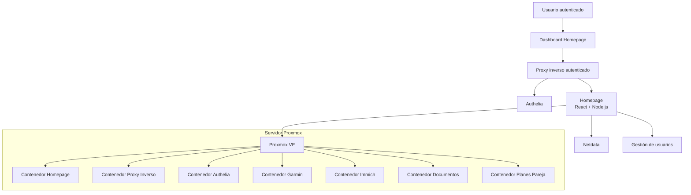
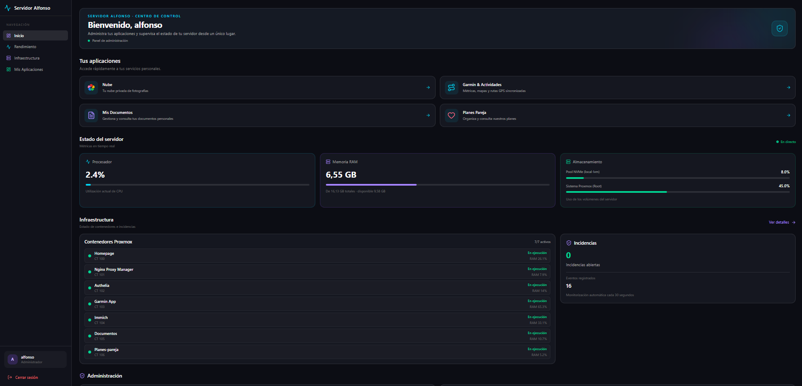
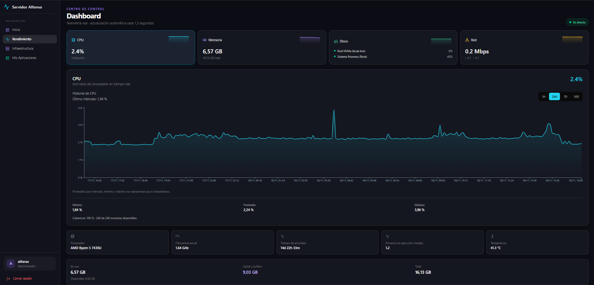
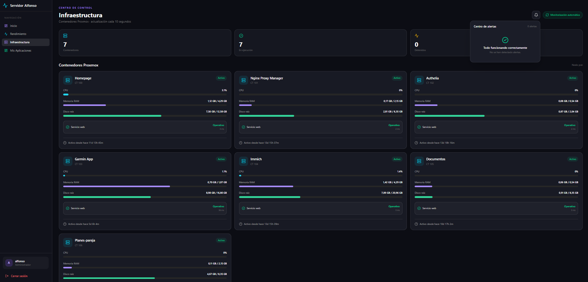
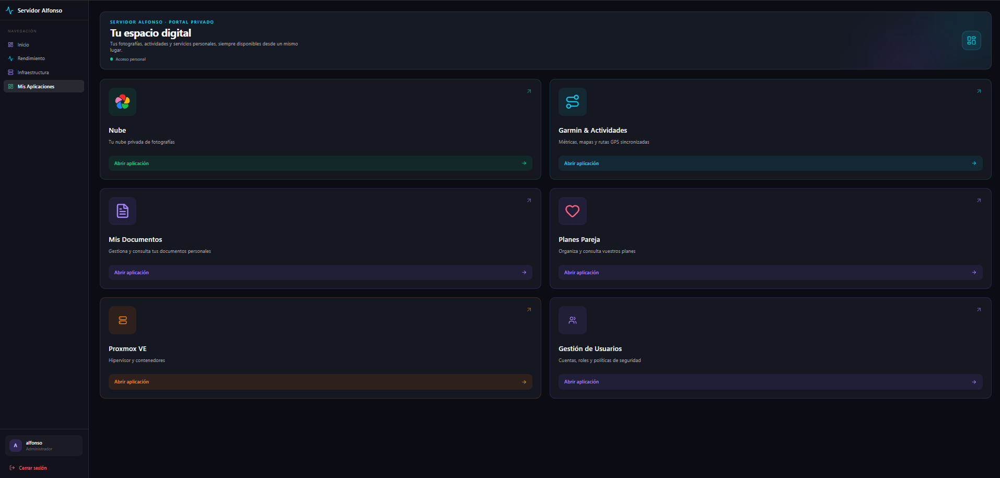
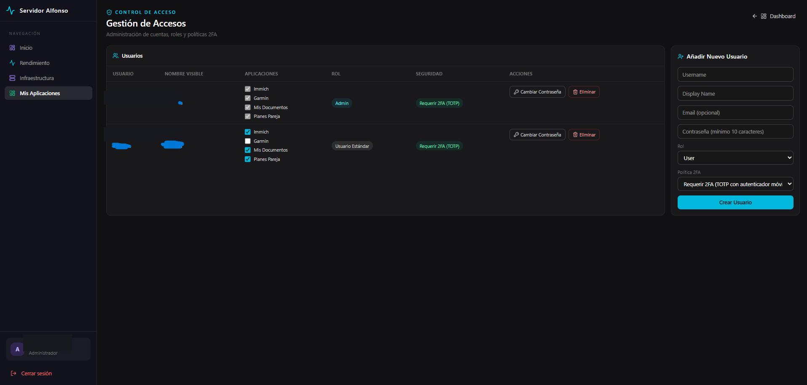
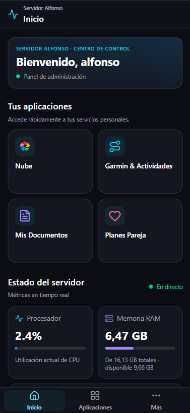

# Homelab Infrastructure | Proxmox & Full Stack Dashboard

**Portal privado de administración, monitorización e integración de servicios autohospedados**

---

## Presentación

**Homelab Infrastructure** documenta la infraestructura doméstica desarrollada sobre **Proxmox VE** y el dashboard **Homepage**, una aplicación Full Stack creada para centralizar el acceso y supervisión de servicios personales.

El sistema combina virtualización, contenedores LXC, autenticación centralizada, monitorización en tiempo real y aplicaciones autohospedadas bajo una interfaz responsive adaptada a escritorio y dispositivos móviles.

Este repositorio constituye una presentación técnica del proyecto. No contiene código fuente, secretos, credenciales ni configuraciones operativas sensibles.

## Estado del proyecto

| Entorno | Estado | Uso |
|---|---|---|
| **Producción** | Operativo | Dashboard, métricas, infraestructura, usuarios e integraciones |
| **Preproducción** | Activo para desarrollo | Validación de mejoras antes de su incorporación a producción |
| **Laboratorio** | Experimental aislado | Escenarios sintéticos, pruebas de interfaz y previsualizaciones |

Las aplicaciones visibles en el laboratorio son simulaciones y no acreditan el funcionamiento de las plataformas reales.

---

## Características principales

- Centro de control accesible desde una única interfaz.
- Arquitectura basada en Proxmox VE y contenedores LXC.
- Monitorización en tiempo real mediante Netdata y APIs de Proxmox.
- Métricas históricas de CPU, memoria, disco y red.
- Visualización responsive para escritorio, móvil y tablet.
- Accesos integrados a las aplicaciones privadas.
- Autenticación centralizada con control de identidades y roles.
- 2FA compatible con autenticadores TOTP.
- Gestión administrativa de usuarios y permisos por aplicación.
- Panel de infraestructura con estado de contenedores y alertas.
- Manifest PWA y presentación compatible con instalación desde dispositivos compatibles.
- Navegación optimizada para pantallas táctiles y modos standalone.

---

## Arquitectura del servidor

### Flujo de acceso

1. El usuario accede al portal mediante el proxy inverso.
2. Authelia verifica la identidad y las políticas de autenticación.
3. Homepage recibe la identidad autenticada y determina su rol.
4. El backend habilita únicamente las aplicaciones asignadas al usuario.
5. Las métricas se obtienen de Netdata y el estado de la infraestructura desde Proxmox.
6. Las vistas administrativas quedan restringidas a usuarios con rol administrador.

---

## Contenedores LXC

La infraestructura está organizada en siete contenedores LXC independientes:

| Contenedor | Función principal |
|---|---|
| **Homepage** | Dashboard React, API Node.js y presentación centralizada de los servicios |
| **Nginx Proxy Manager** | Punto de acceso al sistema y gestión de proxies HTTP |
| **Authelia** | Identidad, autenticación, autorización y 2FA |
| **Garmin App** | Métricas deportivas, sincronización de datos y rutas GPS |
| **Immich** | Biblioteca multimedia privada y gestión de fotografías |
| **Documentos** | Almacenamiento, consulta y organización de documentos personales |
| **Planes Pareja** | Organización y consulta de planes compartidos |

La separación en contenedores permite aislar servicios, asignar recursos de forma independiente y supervisar su consumo desde Homepage.

---

## Funcionamiento del dashboard Homepage

Homepage ofrece una vista centralizada de las aplicaciones y del estado del servidor.

### Inicio

- Presenta una bienvenida personalizada.
- Distingue entre usuarios estándar y administradores.
- Muestra accesos rápidos según los permisos individuales.
- Resume recursos, infraestructura e incidencias recientes.

### Rendimiento

- Consulta la telemetría mediante Netdata.
- Obtiene el estado general y los volúmenes desde Proxmox.
- Actualiza la información automáticamente.
- Permite seleccionar CPU, memoria RAM, almacenamiento o red.

### Infraestructura

- Lista los contenedores disponibles.
- Muestra CPU, RAM y almacenamiento de cada LXC.
- Indica contenedores activos o detenidos.
- Genera alertas ante recursos elevados o servicios sin respuesta.
- Permite a los administradores supervisar el estado de la plataforma.

### Aplicaciones

- Centraliza los enlaces a las distintas plataformas privadas.
- Cada aplicación puede visualizarse integrada o abrirse en una ventana independiente.
- El acceso se controla mediante los permisos individuales del usuario.

---

## Monitorización en tiempo real

El dashboard muestra las principales métricas del servidor:

- Uso de CPU.
- Uso de memoria RAM.
- Memoria disponible y caché.
- Volúmenes y almacenamiento disponible.
- Tráfico de entrada y salida de red.
- Actividad de lectura y escritura.
- Temperatura y frecuencia del procesador.
- Tiempo de actividad y procesos.
- Estado y consumo individual de los contenedores.

Los datos del dashboard se actualizan periódicamente y mantienen indicadores visuales de disponibilidad para evitar presentar información obsoleta como activa.

## Gráficas históricas y filtros temporales

Las métricas históricas incorporan filtros para:

- `1H`
- `24H`
- `7D`
- `30D`

Las gráficas permiten:

- Seleccionar la métrica mostrada.
- Consultar el último intervalo registrado.
- Visualizar estadísticas de la serie.
- Identificar tendencia, mínimo, máximo y promedio.
- Consultar los valores mediante tooltip interactivo.
- Diferenciar claramente entre muestras instantáneas y promedios agregados.

> Los intervalos sin datos no se convierten artificialmente en cero.

---

## Aplicaciones integradas

### Immich

Galería multimedia privada para fotografías y vídeos, integrada dentro del dashboard y disponible también como aplicación independiente.

### Garmin & Actividades

Dashboard dedicado a métricas deportivas, actividad física, rutas GPS y sincronización de datos.

### Mis Documentos

Gestor de documentos personales accesible mediante una vista integrada y acceso directo a su interfaz.

### Planes Pareja

Aplicación privada para organizar y consultar planes compartidos.

El contenido interno de cada integración no se replica ni almacena dentro de Homepage. El dashboard actúa como portal de acceso y navegación.

---

## Autenticación y autorización

Homepage utiliza una arquitectura basada en proxy autenticado:

- Identidad obtenida a través de cabeceras proporcionadas por la capa de autenticación.
- Validación del usuario contra la base de identidades configurada.
- Roles diferenciados: **administrador** y **usuario estándar**.
- Protección del backend mediante sesión y rol validado.
- Aplicaciones filtradas según permisos individuales.
- Restricciones adicionales para las rutas administrativas.
- Integración con políticas 2FA administradas mediante Authelia.
- Soporte para contraseñas y autenticación TOTP.

Las rutas administrativas requieren rol de administrador y no pueden utilizarse como sustituto de la autenticación centralizada.

---

## Gestión de usuarios

El panel de control permite a los administradores:

- Consultar usuarios registrados.
- Crear nuevas cuentas.
- Asignar roles de administrador o usuario estándar.
- Configurar políticas de contraseña o 2FA.
- Cambiar contraseñas.
- Eliminar usuarios.
- Asignar permisos para Immich, Garmin, Documentos y Planes Pareja.
- Mantener activos todos los permisos para cuentas administrativas.

La interfaz presenta el estado de seguridad de cada cuenta sin mostrar datos sensibles.

---

## Diseño responsive y PWA

La interfaz utiliza una navegación adaptada al tamaño de pantalla:

- Barra lateral en escritorio.
- Navegación inferior en dispositivos móviles.
- Menú compacto para opciones adicionales.
- Tarjetas y controles adaptados al tacto.
- Integraciones encapsuladas en vistas flexibles.
- Restauración de navegación mediante historial móvil.
- Objetivos táctiles ampliados.
- Safe areas para dispositivos con notch.
- Manifest de aplicación y compatibilidad con modo standalone.
- Iconos preparados para dispositivos móviles.

El proyecto dispone de un manifest PWA y metadatos para instalación. No se presenta como una aplicación offline: el laboratorio no incorpora service worker ni almacenamiento offline.

---

## Tecnologías utilizadas

### Frontend

- React 19
- Vite
- JavaScript
- Tailwind CSS
- Recharts
- Lucide React
- Radix UI Dialog
- CSS responsive

### Backend

- Node.js
- Express
- bcryptjs
- APIs REST
- Integración con Proxmox
- Integración con Netdata
- Sincronización administrativa de usuarios

### Infraestructura

- Proxmox VE
- Contenedores LXC
- Linux
- Authelia
- Proxy inverso
- Netdata
- Immich
- Autohospedaje privado

### Experiencias en desarrollo

La preproducción incluye escenarios controlados para:

- Mejora del diseño móvil.
- Pruebas de navegación e historial.
- Simulación de perfiles administrativos y usuarios limitados.
- Previsualización histórica de métricas.
- Validación de interfaces de integración.
- Comprobaciones aisladas de funcionamiento y permisos.

Estas capacidades permanecen clasificadas como laboratorio hasta su validación y despliegue.

---

## Galería de capturas

### Dashboard principal

Vista central con aplicaciones personales, estado del servidor e infraestructura principal.

### Monitorización

Telemetría en tiempo real y gráficas históricas de CPU, memoria, disco y red.

### Infraestructura

Supervisión de contenedores LXC, recursos y estado de los servicios.

### Aplicaciones

Accesos centralizados a la nube privada, Garmin, documentos, planes y administración.

### Gestión de usuarios

Administración de cuentas, roles, permisos por aplicación y políticas 2FA.

### Vista móvil

Interfaz optimizada para navegación táctil y dispositivos móviles.

---

## Competencias demostradas

- Desarrollo Full Stack con React y Node.js.
- Diseño de APIs REST y integración de servicios.
- Administración avanzada de servidores Linux.
- Virtualización y gestión de contenedores LXC.
- Arquitectura de sistemas distribuidos.
- Monitorización de infraestructura.
- Autenticación y control basado en roles.
- Integración de 2FA y permisos por aplicación.
- Diseño responsive y accesible.
- Interfaces PWA.
- Visualización de datos mediante gráficas y telemetría.
- Separación entre producción, preproducción y laboratorio.
- Validación progresiva de funcionalidades y cambios.

---

## Autor

**Alfonso Carrasco Salgueiro**

- GitHub: [alfonsocarrascosalgueiro](https://github.com/alfonsocarrascosalgueiro)
- LinkedIn: [Alfonso Carrasco Salgueiro](https://www.linkedin.com/in/alfonso-carrasco-salgueiro-2b7a95224/)
